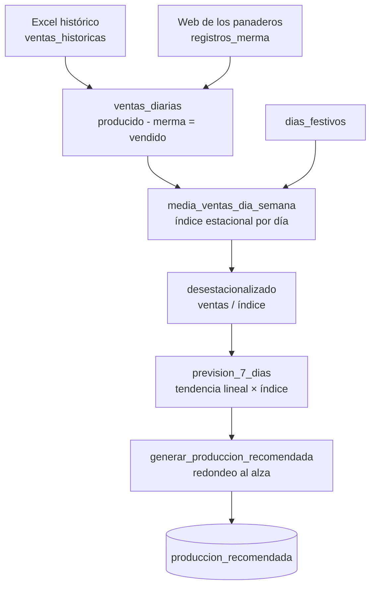

# Previsión de demanda y reducción de merma para panaderías

Modelo de previsión de ventas a 7 días, construido íntegramente en **PostgreSQL / Supabase**, que le dice a un obrador cuántas unidades de cada producto hornear cada mañana.

> **English summary.** A 7-day demand-forecasting model for artisan bakeries, written in plain SQL on Supabase (PostgreSQL). It combines weekly seasonal indices (with public holidays treated as Sundays), deseasonalisation and a linear trend, and writes a rounded-up production order per product and day. A pilot with a local bakery, run on the earlier spreadsheet version of the model, cut total waste from 28 % to 20 %.

---

## El problema

Una panadería artesanal hornea de madrugada sin saber cuánto venderá. Lo que sobra al cierre se tira (pan del día), y lo que falta es una venta perdida. El coste no es simétrico: cada barra tirada cuesta materia prima, energía y mano de obra, mientras que la producción se decide "a ojo" según la experiencia del panadero.

## Resultado

En una **prueba piloto con una panadería artesanal**, con la primera versión del modelo (en hoja de cálculo):

| Métrica | Antes | Con el modelo |
|---|---|---|
| Merma sobre lo producido | 28 % | **20 %** |
| Producto horneado que se vende | — | **+5 puntos porcentuales** |

Después pasé el modelo a SQL para que funcionara de forma automática con los datos que los panaderos registran cada día desde el móvil. Ese es el código de este repositorio.

## Cómo funciona



1. **Demanda diaria.** Se unen el histórico importado y los registros diarios de la web. Lo producido (fichaje de mañana) y la merma (fichaje de cierre) llegan por separado y se agregan por día y producto.
2. **Estacionalidad semanal.** Para cada producto se calcula un índice por día de la semana: `media del día / media global`. Los **festivos se agrupan con los domingos**, porque se comportan igual, y no contaminan la media de su día laborable.
3. **Desestacionalización.** Cada venta se divide por el índice de su día. Así, un domingo de 35 barras y un martes de 15 pueden valer lo mismo, y queda a la vista la tendencia de fondo del negocio.
4. **Tendencia.** Regresión lineal (`regr_slope`, `regr_intercept`) sobre la serie desestacionalizada, usando días naturales como eje X para respetar los días cerrados.
5. **Previsión.** Se proyecta la recta a los 7 días siguientes y se vuelve a multiplicar por el índice del día correspondiente.
6. **Orden de producción.** Se redondea siempre hacia arriba y se guarda con *upsert*. Se puede programar con `pg_cron` para que se genere a las 4:00.

El detalle matemático y las decisiones de diseño están en [docs/modelo.md](docs/modelo.md).

## Estructura

```
sql/
├── 00_dependencias.sql            tablas de la app web (no son mías, ver Créditos)
├── 01_tablas.sql                  histórico, festivos y salida del modelo
├── 02_funciones.sql               grupo_dia(), normalizar_producto()
├── 03_vistas.sql                  la cadena de cálculo del modelo
├── 04_produccion_recomendada.sql  genera la orden de producción (+ pg_cron)
├── 05_seguridad.sql               Row Level Security
└── 99_datos_ejemplo.sql           8 semanas de datos sintéticos para probarlo
```

## Probarlo

En un proyecto de Supabase vacío (o cualquier PostgreSQL 15 o superior), ejecuta los archivos de `sql/` en orden en el SQL Editor y después:

```sql
SELECT generar_produccion_recomendada();

SELECT producto_id, fecha, cantidad_recomendada
FROM produccion_recomendada
ORDER BY producto_id, fecha;
```

Los datos de ejemplo son **sintéticos**. No se incluye ningún dato real de clientes.

## Problemas reales que resolví por el camino

- **Tipos mezclados en el identificador de producto.** La web guardaba unas veces el ID (`"12"`) y otras el nombre (`"barra-grande"`), lo que provocaba errores `text = bigint` y `invalid input syntax for type bigint` en cadena. Se resolvió con `normalizar_producto()`, que compara siempre como texto y normaliza mayúsculas y guiones.
- **Excel y SQL daban previsiones distintas** con los mismos índices. La causa era que Excel numera las filas (1, 2, 3…) e ignora los días sin datos, mientras que SQL usaba fechas reales. Opté por las fechas reales, porque un cierre de dos semanas en agosto no debe "acelerar" la tendencia.
- **Vistas que se saltaban la seguridad.** Por defecto, una vista de Postgres ignora el RLS de sus tablas. Todas usan `security_invoker = true`.
- **Fichajes partidos y anulaciones.** Producción y merma se registran en momentos distintos del día y algunos registros se anulan. La vista agrega por día y excluye los anulados.

## Limitaciones y siguientes pasos

- La tendencia lineal es deliberadamente sencilla: con pocas semanas de datos, un modelo más complejo sobreajusta. Con 1 o 2 años de histórico, el siguiente paso sería **Holt-Winters** o **ETS**, con estacionalidad anual (verano, Navidad).
- Los productos de **baja rotación**, con muchos días a cero, necesitan otro tratamiento. En la versión Excel usaba la media de los días con venta, redondeada.
- Faltaría medir también las **roturas de stock** (días en que se agotó el producto), no solo la merma, porque un modelo que reduce la merma a costa de quedarse sin pan no ayuda al negocio.

## Por qué no siguió adelante

El piloto funcionó, pero el proyecto no encontró clientes. Las cadenas de panaderías a las que presenté la propuesta ya estaban haciendo pruebas piloto con otras empresas, no tenían interés o no respondieron. Lo publico como ejemplo de un proyecto de datos completo: problema real, prototipo, validación con un cliente y paso a producción.

## Créditos

- **Hugo Angel Torres**: modelo de previsión, diseño de las tablas y vistas de este repositorio.
- **Martí Rocamora Maldonado**: aplicación web de captura de datos y automatizaciones con n8n (no incluidas aquí, salvo las dos tablas mínimas de `00_dependencias.sql`).

Desarrollado con apoyo de asistentes de IA (Gemini, Claude) para la parte de SQL.

## Licencia

[MIT](LICENSE)
